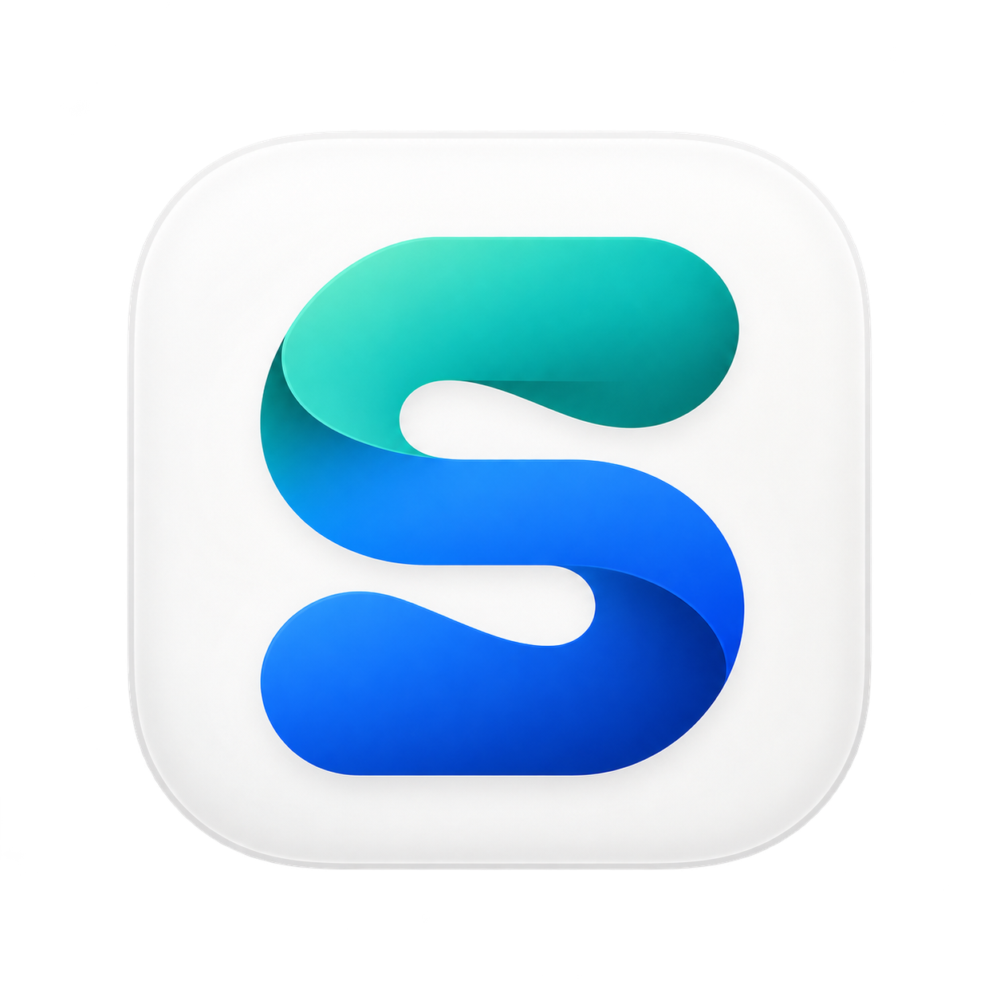
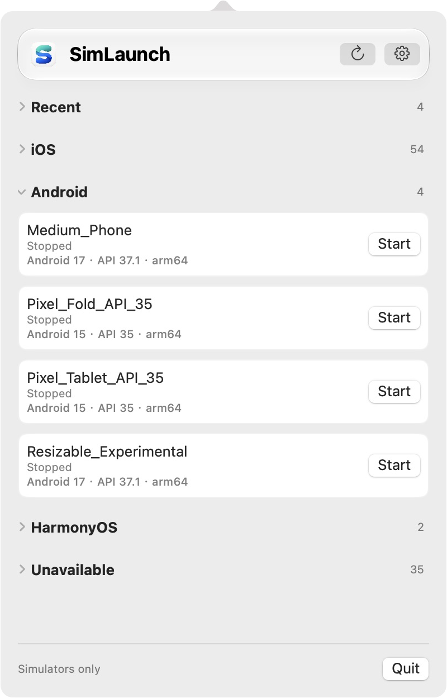
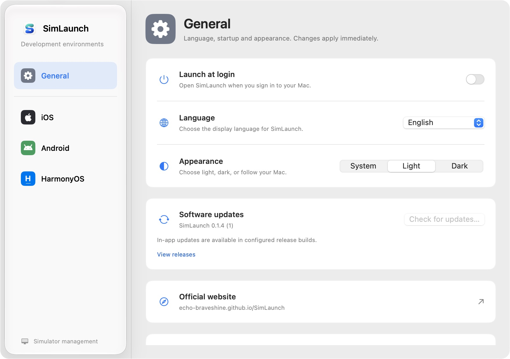
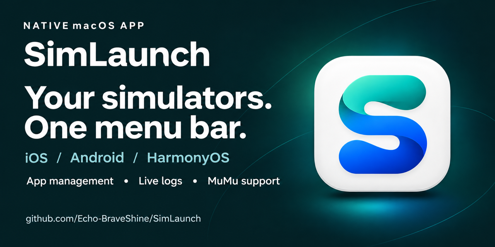

<p align="center">
  
</p>

<h1 align="center">SimLaunch</h1>

<p align="center"><a href="README.md">简体中文</a> · <strong>English</strong></p>

<p align="center"><strong>Three platforms. One menu bar.</strong></p>
<p align="center">Manage iOS, Android, HarmonyOS and MuMu simulators on macOS.<br>Launch devices, install apps and follow logs with less switching between tools.</p>

<p align="center">
  <a href="https://echo-braveshine.github.io/SimLaunch/?lang=en">Website</a> ·
  <a href="https://github.com/Echo-BraveShine/SimLaunch/releases/latest">Download</a> ·
  <a href="https://github.com/Echo-BraveShine/SimLaunch/issues">Report an issue</a> ·
  <a href="docs/GUIDE.md">User & Developer Guide (Chinese)</a>
</p>

<p align="center">macOS 13+ · Native SwiftUI · English / 简体中文 · MIT</p>

## Everyday tools for simulator development

| Feature | What you can do |
| --- | --- |
| **One device list** | Browse, start and stop iOS, Android AVD, HarmonyOS and MuMu for Mac devices from the menu bar. |
| **Recent devices** | Keep up to five recently used devices at the top. Collapse platform groups and remember their state. |
| **App management** | Search installed apps, inspect names and versions, and uninstall user apps. Drag in installation packages or choose them from a file picker. |
| **Live logs** | Search, filter by level or PID, copy and export in a dedicated panel. Scroll up to pause automatic following while reading earlier messages. |
| **Device information** | Inspect configuration, system versions and details reported by platform tools. Search, copy or export the information. |
| **Context menus** | Copy device names or UDIDs, reveal device folders in Finder, and cold boot or delete devices where supported. |
| **Native appearance & preferences** | Light, dark and system appearance, English and Chinese, and launch at login. Selected surfaces use Liquid Glass on supported systems. |

## See the app

<picture>
  <source media="(prefers-color-scheme: dark)" srcset="website/assets/devices-en-dark.png">
  
</picture>

<details>
<summary>View General settings</summary>

<picture>
  <source media="(prefers-color-scheme: dark)" srcset="website/assets/settings-en-dark.png">
  
</picture>

</details>

Screenshots are captured from the running app and switch with the page's light or dark appearance. Devices and available features depend on your setup and installed version.

## Install

### Download

Download the universal ZIP from [GitHub Releases](https://github.com/Echo-BraveShine/SimLaunch/releases/latest), extract it and move **SimLaunch.app** to your Applications folder.

Launching opens the device panel anchored to the menu bar icon. Click the SimLaunch icon at the top of your screen to show or hide it. The app has no Dock icon.

### Homebrew

```sh
brew tap echo-braveshine/simlaunch https://github.com/Echo-BraveShine/SimLaunch.git
brew install --cask echo-braveshine/simlaunch/simlaunch
```

For upgrades and removal, see the [Homebrew guide (Chinese)](docs/HOMEBREW.md).

> **First launch:** Current releases are not signed with Apple Developer ID or notarized by Apple. If macOS blocks the app, verify that you downloaded it from this project's GitHub Release. Try opening it once, then go to **System Settings → Privacy & Security → Open Anyway** and follow the prompts. See [Apple's instructions](https://support.apple.com/en-us/102445).

## Get started

Create simulators in the corresponding development tools before opening SimLaunch. If your tools are installed in a custom location, specify their paths in Settings.

| Platform | Requirements |
| --- | --- |
| iOS | Full Xcode installation and simulator runtimes |
| Android | Android SDK Emulator, ADB and an existing AVD |
| HarmonyOS | DevEco Studio and an existing simulator |
| MuMu | MuMuPlayer for Mac |

App management and live logs require a running device with a working debugging connection. Icons, app details and log availability depend on platform tools and permissions; some resources may be inaccessible.

App installation supports iOS Simulator `.app` bundles, Android / MuMu `.apk` files and split APK sets, and HarmonyOS multi-module `.hap` packages. Updates must satisfy the platform's signing and version requirements. See [app management details (Chinese)](docs/GUIDE.md#应用管理) for supported formats and limitations.

SimLaunch currently focuses on simulators. It does not bundle SDKs or system images, create simulators, or support physical devices.

## Contribute

Use Xcode with the macOS 26 SDK or later. Open `Package.swift`, select **SimLaunch → My Mac**, and run.

```sh
swift test
./scripts/build-app.sh
open dist/SimLaunch.app
```

The detailed guides below are currently available in Chinese.

| Guide | Contents |
| --- | --- |
| [User & Developer Guide](docs/GUIDE.md) | Tool paths, platform compatibility, feature details, tests and source entry points |
| [Releases & Updates](docs/RELEASING.md) | GitHub Actions, Sparkle, signing and release configuration |
| [Website Maintenance](docs/WEBSITE.md) | Bilingual website, screenshots and GitHub Pages deployment |
| [Licensing Notes](docs/LICENSING.md) | MIT license and third-party distribution notices |

Questions, bug reports and suggestions are welcome in [Issues](https://github.com/Echo-BraveShine/SimLaunch/issues). Code contributions are welcome too.



---

<p align="center">Open source under the <a href="LICENSE">MIT License</a>. Free to use.<br>If SimLaunch helps your workflow, consider <a href="https://buymeacoffee.com/1239383708p">buying me a coffee ☕</a> to support development and maintenance.</p>
