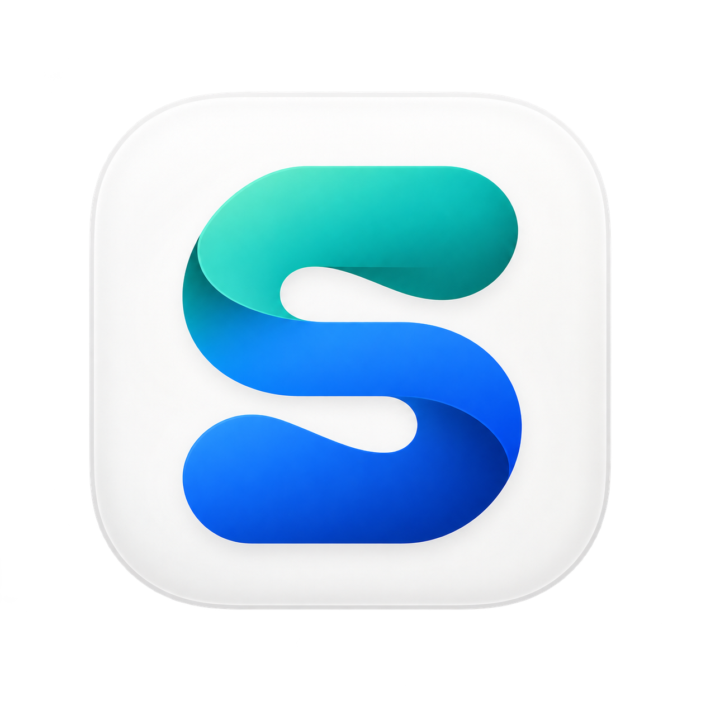
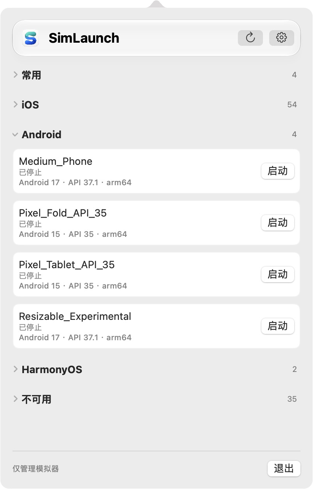
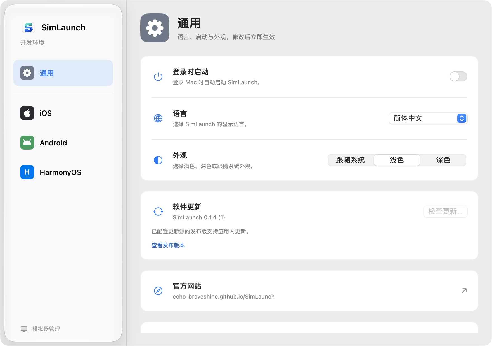
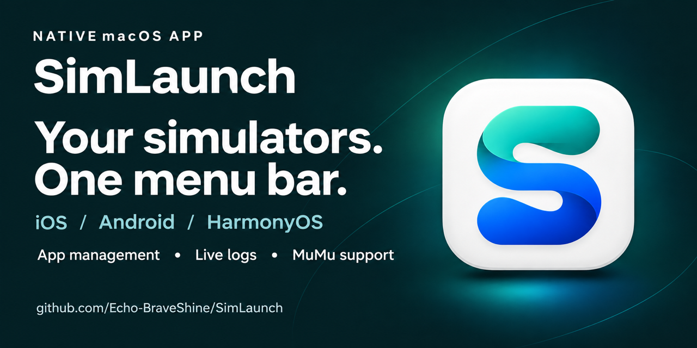

<p align="center">
  
</p>

<h1 align="center">SimLaunch</h1>

<p align="center"><strong>简体中文</strong> · <a href="README.en.md">English</a></p>

<p align="center"><strong>三个平台，一个菜单栏入口。</strong></p>
<p align="center">在 macOS 上管理 iOS、Android、HarmonyOS 和 MuMu 模拟器。<br>启动设备、安装应用、查看日志，让日常开发少一点切换。</p>

<p align="center">
  <a href="https://echo-braveshine.github.io/SimLaunch/">官方网站</a> ·
  <a href="https://github.com/Echo-BraveShine/SimLaunch/releases/latest">下载应用</a> ·
  <a href="https://github.com/Echo-BraveShine/SimLaunch/issues">问题反馈</a> ·
  <a href="docs/GUIDE.md">使用与开发手册</a>
</p>

<p align="center">macOS 13+ · 原生 SwiftUI · 简体中文 / English · MIT</p>

## 为模拟器开发准备的日常工具

| 功能 | 体验 |
| --- | --- |
| **统一设备管理** | 从菜单栏查看、启动和停止设备；支持 iOS、Android AVD、HarmonyOS 与 MuMu Mac 版。 |
| **常用设备** | 最近使用的设备置顶，最多显示 5 项；平台分类可折叠并记住状态。 |
| **应用管理** | 搜索已安装应用、查看名称与版本详情、卸载用户应用；支持拖入或选择安装包。 |
| **实时日志** | 独立日志面板，支持搜索、级别与 PID 筛选、复制和导出；向上滚动时暂停自动跟随。 |
| **设备信息** | 查看设备配置、系统版本和工具提供的详细信息，支持搜索、复制与导出。 |
| **顺手的右键操作** | 复制设备名称或 UDID、在访达中显示目录，以及适用设备的冷启动和删除。 |
| **原生外观与偏好** | 深浅色与跟随系统、中英文切换、登录时启动；支持系统的部分界面使用 Liquid Glass。 |

## 看看实际界面

<picture>
  <source media="(prefers-color-scheme: dark)" srcset="website/assets/devices-zh-dark.png">
  
</picture>

<details>
<summary>查看通用设置</summary>

<picture>
  <source media="(prefers-color-scheme: dark)" srcset="website/assets/settings-zh-dark.png">
  
</picture>

</details>

截图来自实际运行的 App，随页面深浅色外观切换；设备与可用功能以本机环境及所安装版本为准。

## 安装

### 直接下载

从 [GitHub Releases](https://github.com/Echo-BraveShine/SimLaunch/releases/latest) 下载通用版 ZIP，解压后将 **SimLaunch.app** 移入“应用程序”。

启动后会展开状态栏设备面板。点击屏幕顶部的 SimLaunch 图标可再次展开或收起；应用不显示 Dock 图标。

### Homebrew

```sh
brew tap echo-braveshine/simlaunch https://github.com/Echo-BraveShine/SimLaunch.git
brew install --cask echo-braveshine/simlaunch/simlaunch
```

升级与卸载方式见 [Homebrew 说明](docs/HOMEBREW.md)。

> **首次打开**：当前发布版未使用 Apple Developer ID 签名，也未通过 Apple 公证。若 macOS 拦截打开，请确认来自本项目的 GitHub Release，尝试打开一次后，前往 **系统设置 → 隐私与安全性 → 仍要打开**，按提示确认。详见 [Apple 官方说明](https://support.apple.com/zh-cn/102445)。

## 开始使用

先在对应开发工具中创建模拟器，再打开 SimLaunch；工具安装在自定义位置时，可在设置中指定路径。

| 平台 | 需要准备 |
| --- | --- |
| iOS | 完整 Xcode 与模拟器运行时 |
| Android | Android SDK 的 Emulator、ADB 和已创建的 AVD |
| HarmonyOS | DevEco Studio 与已创建的模拟器 |
| MuMu | MuMuPlayer Mac 版 |

应用管理与实时日志需要设备运行并建立调试连接。图标、应用信息和日志范围受平台工具及权限限制；部分资源可能无法读取。

安装应用支持 iOS 模拟器 `.app`、Android / MuMu 的 `.apk` 与拆分 APK，以及鸿蒙 `.hap` 多模块包。覆盖安装需满足平台的签名与版本要求，具体格式和限制见 [应用管理说明](docs/GUIDE.md#应用管理)。

目前专注于模拟器，不包含 SDK 或系统镜像，也不负责创建模拟器；真机支持尚未实现。

## 参与开发

使用包含 macOS 26 或更新 SDK 的 Xcode，在 Xcode 中打开 `Package.swift`，选择 **SimLaunch → My Mac** 后运行。

```sh
swift test
./scripts/build-app.sh
open dist/SimLaunch.app
```

| 文档 | 内容 |
| --- | --- |
| [使用与开发手册](docs/GUIDE.md) | 路径配置、平台兼容性、功能细节、测试与源码入口 |
| [发布与自动更新](docs/RELEASING.md) | GitHub Actions、Sparkle、签名与发布配置 |
| [官网维护](docs/WEBSITE.md) | 中英文官网、截图与 GitHub Pages 部署 |
| [许可证说明](docs/LICENSING.md) | MIT 许可与第三方分发说明 |

欢迎通过 [Issues](https://github.com/Echo-BraveShine/SimLaunch/issues) 提交问题或建议，也欢迎贡献代码。



---

<p align="center">使用 <a href="LICENSE">MIT License</a> 开源，免费使用。<br>如果 SimLaunch 对你有帮助，欢迎 <a href="https://buymeacoffee.com/1239383708p">请我喝杯咖啡 ☕</a>，支持后续开发与维护。</p>
