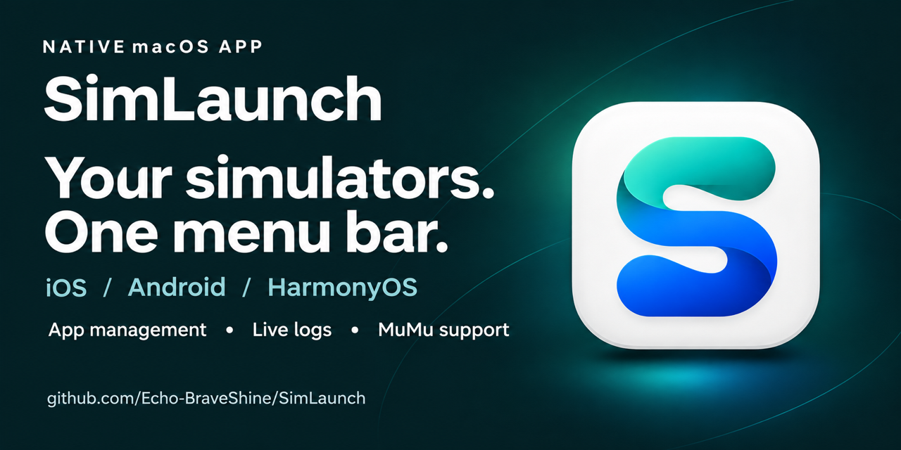

# 使用与开发手册

[← 返回项目首页](../README.md)

## 应用与版本

当前应用 Bundle ID 为 `dev.ekko.simlaunch`。

应用信息统一维护在根目录 `Info.plist`：`CFBundleShortVersionString` 是版本号，`CFBundleVersion` 是本地默认构建号。打包时复制该文件；正式发布要求 Git 标签 `vX.Y.Z` 与其中的版本号一致，CI 单独生成递增构建号。设置页面、Sparkle 和 Homebrew 均读取最终应用包的版本信息。直接通过 Swift Package / Xcode 运行未打包的可执行文件时，设置页面仍显示开发模式标识。

项目通过 Swift Package 管理，默认开发模式没有第三方 Swift 包依赖；正式更新版通过 `SIMLAUNCH_ENABLE_SPARKLE=1` 启用固定版本的 Sparkle 2.10.1。各平台功能仍依赖本机安装的 Xcode、Android SDK、MuMuPlayer 或 DevEco Studio；SimLaunch 不负责创建模拟器、下载 SDK、安装系统镜像或接受开发工具许可。


## 环境要求

| 用途 | 要求 |
| --- | --- |
| 运行应用 | 部署目标为 macOS 13+；尚未在全部支持版本上完成实机验证 |
| 编译源码 | 使用包含 macOS 26 或更新 SDK 的 Xcode，以编译 Liquid Glass 接口；当前本机验证环境为 Xcode 27.1、Swift 6.4、Apple Silicon |
| iOS 管理 | 完整 Xcode、可用的 simctl，以及与设备运行时兼容的 Simulator.app 或 DeviceHub.app |
| MuMu 管理 | MuMuPlayer Mac 版及其 mumutool；管理器关闭时可从本地目录读取设备，日志需要运行设备及可用的 ADB 连接 |
| Android 管理 | Android SDK 中的 emulator、adb；删除 AVD 还需要 avdmanager 及其可用的 Java 运行环境 |
| HarmonyOS 管理 | DevEco Studio 的 Emulator CLI；当前解析基于本机 DevEco Studio 26 的实际 JSON 输出 |

`Package.swift` 中的 `swift-tools-version: 5.9` 是包清单的工具版本声明，不代表使用旧版 Xcode / SDK 即可编译当前源码。

## Homebrew 安装

已接入自定义 Homebrew Cask 分发。需先将本次改动推送并成功发布一个新版本，确认工作流已在默认分支生成 `Casks/simlaunch.rb`，之后可执行：

```sh
brew tap echo-braveshine/simlaunch https://github.com/Echo-BraveShine/SimLaunch.git
brew install --cask echo-braveshine/simlaunch/simlaunch
```

这会安装 Release 应用包，SDK 仍需单独准备。升级、卸载及自动维护说明见 [Homebrew 说明](../docs/HOMEBREW.md)。

中英文官网源码位于 `website/`，支持跟随系统、浅色、深色外观，应用截图随语言和外观同步切换，包含 GitHub Pages 自动部署配置。本地预览、启用 Pages 和维护方式见 [官网说明](../docs/WEBSITE.md)。

### 首次打开：允许 macOS 安全提示

当前发布版尚未使用 Apple Developer ID 证书签名，也未通过 Apple 公证。无论通过 Homebrew 安装还是从 GitHub Releases 下载，首次打开时都可能被 macOS 拦截，提示无法验证开发者或 Apple 无法检查该应用。

确认应用来自本项目的 GitHub Release 后，按以下步骤允许打开：

1. 在“应用程序”中打开一次 `SimLaunch.app`，使系统显示拦截提示。
2. 打开 **系统设置 → 隐私与安全性**，向下滚动至“安全性”区域。
3. 找到 SimLaunch 的拦截记录，点击 **仍要打开**（Open Anyway）。
4. 按系统提示完成身份验证，并在确认弹窗中点击 **打开**。

菜单和按钮文字可能随 macOS 版本略有不同。具体步骤见 [Apple 官方说明](https://support.apple.com/zh-cn/102445)。

## 构建与运行

在项目根目录执行：

```sh
# 编译 Debug 可执行文件
swift build

# 执行测试，默认不启动或删除真实设备
swift test

# 生成本机架构的 Release 应用包，包含图标和本地化资源
./scripts/build-app.sh

open dist/SimLaunch.app
```

打包脚本使用 macOS 自带的 sips、iconutil、ditto 和 codesign，生成临时签名（ad hoc）的 `dist/SimLaunch.app`，并尝试刷新该路径的系统应用注册。本地默认生成本机架构二进制；设置 `APP_ARCHITECTURES=universal` 可生成 arm64 / x86_64 通用包。正式发布工作流支持更新归档签名，以及可选的 Developer ID 签名和 Apple 公证，详见 [发布说明](../docs/RELEASING.md)。

应用包设置了 `LSUIElement`，作为仅状态栏应用运行，不在 Dock 或应用切换器中显示；直接运行源码也使用相同策略。打开应用直接显示锚定状态栏图标的设备面板，不再创建独立设备主窗口。点击状态栏图标可展开或关闭面板；重复打开应用会复用该面板。齿轮按钮打开独立设置窗口，关闭设置不会退出应用。

### 使用 Xcode 调试

1. 在 Xcode 中打开 `Package.swift`。
2. 选择 SimLaunch scheme 和 My Mac 运行目标。
3. 先退出正在运行的另一份 SimLaunch，再按 ⌘R 编译、运行；添加断点后可调试应用自身代码，⌘U 执行测试。

也可用 `swift run SimLaunch` 运行。Swift Package 直接运行的产物是可执行文件，并不等同于打包脚本生成的 `.app`；当前登录项开关要求运行于应用包中。

## 设备列表与操作

- 按 iOS、Android、HarmonyOS 分组；各分类支持展开与收起，并分别保存状态，重启和切换语言后仍保留。没有可显示设备的平台不展示分类，不可用设备放入单独的可折叠“不可用”分类。所有平台均无设备且查询成功时，统一显示一条空列表提示；查询失败时保留错误提示。
- “常用”位于列表顶部，记录通过 SimLaunch 成功启动到目标状态或成功执行 iOS“显示”的设备，最近一次排在最前，最多显示 5 台当前可用的设备。记录保存在本机；没有可显示记录时隐藏，已删除或当前不可用的设备不显示。它不追踪其他开发工具中的使用行为，平台分组仍保留完整列表。
- 启动、停止和删除前重新查询设备状态；同一设备操作期间禁用重复操作。不同工具同时修改设备状态时仍可能出现竞争，错误会提示重试。
- 完成一轮查询后等待约 5 秒再自动刷新，也可手动刷新。自动查询不显示加载动画；用户点击刷新后，刷新按钮原位显示加载动画，完成后恢复图标。若自动查询正在进行，手动刷新会复用该轮查询并显示其进度。三个平台依次查询，因此实际刷新间隔包含查询耗时；某平台失败会保留它原有条目并标记状态未知，随后继续查询其他平台。
- 查询错误显示在列表中，操作错误使用弹窗。Android AVD / HarmonyOS 启动器输出写入 `~/Library/Logs/SimLaunch/`；该目录不是所有操作的统一日志。

### 右键菜单

| 操作 | 适用平台 | 条件与行为 |
| --- | --- | --- |
| 复制设备名称 | 全部 | 复制设备原名 |
| 复制设备 UDID | iOS | 复制 simctl 返回的 UDID |
| 在访达中显示 | 全部 | 定位设备数据目录；无法解析路径时禁用，目录不存在时提示错误 |
| 冷启动 | Android AVD、HarmonyOS | 仅已停止设备可用；Android 使用 `-no-snapshot-load`，HarmonyOS 使用 `-bootMode coldboot`，不请求清空用户数据 |
| 删除当前设备 | 全部 | 仅已停止设备可用，iOS 不可用设备也允许删除；需确认，并再次查询状态后执行 |

删除调用平台工具：iOS 使用 `simctl delete UDID`，Android 使用 `avdmanager delete avd -n NAME`，HarmonyOS 使用 `Emulator -delete NAME -force`。这会删除所选虚拟设备及其数据，无法通过 SimLaunch 撤销；不会请求卸载共享系统镜像。当前项目未通过删除现有用户设备进行端到端验证。

“在访达中显示”的路径来源：iOS 优先使用 simctl 的 dataPath，缺失时回退到用户默认 CoreSimulator 设备目录；Android 读取 AVD 的 `.ini` 配置；HarmonyOS 使用 instancePath；MuMu 使用 CLI 返回的 bundle_path 或本地 vms 映射。自定义设备集合、缺失配置或缺失目录可能导致该功能不可用。

## 设置

左侧仅保留“通用”和三个平台的导航。平台路径修改需点击“保存并刷新”；“恢复自动查找”清空当前平台的手动配置，也需要保存；已经全部留空时，该按钮不可用。“自动查找”标签仅表示该字段留空后的查找模式，不代表工具已安装或检测成功。保存前会检查手动路径是否指向所需的可执行文件、模拟器应用或目录；无效路径会在设置页提示，不会覆盖已保存的配置。此检查不验证外部工具版本、许可状态或实际启动能力，设备查询错误仍显示在主面板中。

### 通用

- **外观**：跟随系统、浅色、深色，默认跟随系统。切换后立即应用到设备面板和设置页，并保存供下次启动使用；不修改 macOS 的全局外观设置。
- **语言**：简体中文、English、跟随系统，立即生效并保存。界面、设备状态及应用定义的错误提示提供中英文；设备原名、外部 CLI 输出和系统生成的诊断保留原文。系统原生界面可能遵循系统语言。
- **登录时启动**：使用 `SMAppService.mainApp` 注册或取消登录项，立即生效，不依赖路径保存按钮。开关读取系统状态；需要批准时显示提示和系统设置入口。建议先将应用放在固定位置（如 `/Applications`）再启用。该功能已接入系统接口，但尚未通过注销或重启完成自动启动验证。

- **官方网站**：点击官网卡片，在默认浏览器中打开 [SimLaunch 官网](https://echo-braveshine.github.io/SimLaunch/)。

### 平台路径

| 配置 | 自动发现顺序 / 手动填写 |
| --- | --- |
| Xcode 开发者目录 | 默认使用 xcrun 当前选择的工具链；手动填写如 `/Applications/Xcode-beta.app/Contents/Developer`，通过子进程 DEVELOPER_DIR 生效 |
| 模拟器应用 | 检查所选 Xcode 的 Developer/Applications 和 Contents/Applications 中的 Simulator.app、DeviceHub.app，并使用 Spotlight 补充候选；可手动指定 `.app` 路径 |
| Android Emulator | ANDROID_HOME、ANDROID_SDK_ROOT、`~/Library/Android/sdk`、继承的 PATH；手动填写 emulator 可执行文件路径 |
| Android ADB | 优先尝试所选 emulator 同一 SDK 下的 platform-tools/adb，再检查 SDK 环境变量、默认目录、继承的 PATH；可手动指定 |
| Android 虚拟设备目录 | 留空时由 Android 工具及其环境变量决定；手动填写会为子进程设置 ANDROID_AVD_HOME |
| HarmonyOS Emulator | 系统和用户 Applications 下的 DevEco-Studio.app、Spotlight 中的 DevEco 应用、继承的 PATH；可手动指定 Emulator 可执行文件路径 |

图形应用不一定继承终端的环境变量。对于自定义 SDK、未被 Spotlight 索引的安装或多个版本并存的环境，建议显式指定路径。路径支持 `~` 和空格，不要额外添加 shell 引号。

手动 CLI 路径无效时会报错，不会静默改用自动候选。Android 的 avdmanager 从所选 emulator 所在 SDK 的 cmdline-tools（优先 latest）、旧 tools/bin 或继承的 PATH 查找，目前没有单独的手动配置字段。

## 平台实现与兼容边界

### iOS

列表使用 `xcrun simctl list devices --json`；运行时标识转换为可读版本（如 `iOS 18.5`），不可用设备同时保留错误原因；boot、shutdown 和 delete 均针对具体 UDID。不可用状态依据 isAvailable 判断。Booted 映射为“运行中”，不等同于桌面或应用已经完全就绪。

兼容旧版 Simulator.app 和 Xcode 27 的 DeviceHub.app。当前本机 Device Hub 位于 `/Applications/Xcode.app/Contents/Applications/DeviceHub.app`；程序从应用 Info.plist 的 CFBundleExecutable 判断可执行文件。

Device Hub 通过 `devices://device/open?id=<UDID>` 打开目标设备，旧版 Simulator 使用 `-CurrentDeviceUDID` 参数。运行中的 iOS 设备可点击“显示”。窗口打开结果取决于系统和对应 Xcode 应用，不对所有版本的窗口聚焦行为作保证。

### Android

通过 `emulator -list-avds` 查询 AVD，通过 `adb devices` 查询连接端点，仅接受 emulator-* serial，并使用 `adb -s SERIAL emu avd name` 关联 AVD。名称解析兼容 LF 和 CRLF 换行；启动使用 `-avd NAME`，停止使用 `emu kill`。

无法关联名称的启动中 serial 不单独生成设备行，并暂时将未关联 AVD 标记为状态未知以阻止重复启动。AndroidRegistry 保留仍出现在 adb 列表中的 serial 与已确认名称的关联；serial 从列表消失后移除缓存。连接成功但 sys.boot_completed 尚未返回 1 时标记“启动中”，返回 1 后才标记“运行中”。这仍不代表所有应用均已就绪。真正的多个运行实例仍可按 serial 分别停止。

设备详情优先显示 `Android 15 · API 35 · arm64` 这样的系统版本、API 等级和架构。停止时读取 AVD 配置及镜像的 `source.properties`、`build.prop`，支持自定义目录和小数 API 等级；运行就绪后用 getprop 校验并缓存。镜像或配置变化、设备断开后相应缓存失效。不能确认系统版本时仅显示已知的 API / 架构，不根据设备名称猜测版本；serial 保留给设备关联、停止操作和悬停详情。

### MuMu（Android 分类）

支持网易 MuMuPlayer **Mac 版**，设备放在 Android 分类内，以 `MuMu` 标记来源，与 Android Studio AVD 使用独立身份和操作命令。设置 → Android 中可填写 MuMu Tool 路径；留空查找 `/Applications/MuMuPlayer.app/Contents/MacOS/mumutool`、用户 Applications、Spotlight 索引的 MuMu 应用以及继承的 PATH。安装目录变化时可手动指定。

设备列表优先解析 `mumutool info all` 的 JSON，包括实例编号、名称、状态、`bundle_path` 和 `adb_port`。管理服务未启动或尚未就绪时，读取 MuMu 应用标识对应的 `~/Library/Application Support/<bundle-id>/vms/<index>` 映射及目标目录的 `setting/vm.json`，因此 MuMu 未打开时也能显示设备。不会扫描未注册的 `.mad` 备份，也不会使用磁盘中可能过期的 ADB 端口。后台刷新不会打开 MuMu。若有存活的 MuMu 模拟器进程，离线设备保守显示状态未知；进程检查失败则保留查询错误，不将设备误判为已停止。列表中的“运行中”来自 MuMu 管理器，不保证 Android 或 ADB 已就绪。

MuMu 关闭时，点击设备“启动”会通过所选 MuMu 应用打开该设备的 `.mad` 数据包，等待管理服务可用并核对实例目录与编号；如设备已在此过程中启动，则不再次发送启动命令。服务在线时，启动、停止、删除分别调用 `mumutool open INDEX`、`close INDEX`、`delete INDEX`。离线列表中的删除按钮禁用，需要先打开 MuMu 管理器再删除。删除仍需二次确认且只允许已停止设备；修改前重新核对实例身份，避免编号被复用后操作到另一台设备。CLI 即使退出码为 0，也会检查 JSON 内的 `errcode`。未确认支持的冷启动命令不展示。

支持最近使用、复制设备名称、在访达中显示数据包、设备信息和实时日志。设备信息包含所选实例的 CLI 字段、`setting/vm.json` 配置和运行设备的 getprop；读取不到的字段不推测。运行且已连接 ADB 时，列表显示实际 Android 版本、API 和架构；停止时没有可验证的版本来源则只显示 `MuMu · Android`。

MuMu 默认使用应用自带的 ADB；设置中的手动 ADB 路径也适用于 MuMu。后台刷新仅查询已连接的目标；主动打开日志或读取运行信息时，根据所选实例的当前端口执行 `adb connect 127.0.0.1:PORT`，确认此目标在线后再采集 `logcat`，不会挑选其他已连接设备。连接失败请检查 MuMu 的开发者 / ADB 设置并等待系统启动。

默认测试使用模拟 CLI 验证状态解析、精确设备操作、错误处理、编号复用保护、旧配置迁移和 ADB 目标隔离，不启动或删除真实设备。可选本机检查（MuMu 管理器需已打开，已有运行设备时同时读取少量日志和设备信息，不启动、停止或删除设备）：

```sh
SIMLAUNCH_TEST_MUMU=1 swift test --filter MuMuLiveTests

# 可选：MuMu 管理器与设备均已退出时，验证离线发现，不启动设备
SIMLAUNCH_TEST_MUMU_OFFLINE=1 swift test --filter MuMuOfflineLiveTests.testClosedManagerCatalog

# 可选：真实启动指定的离线设备，测试完成后将该设备停止；会打开 MuMu
SIMLAUNCH_TEST_MUMU_START_INDEX=1 swift test --filter MuMuOfflineLiveTests.testStartSelectedOfflineDeviceAndRestoreItToStopped
```

本次兼容依据为本机 MuMuPlayer 1.9.9 / mumutool 1.0.0 的实际输出；其他版本需继续验证，Windows 的 MuMuManager.exe 不在支持范围内。已在本机验证 MuMu 完全退出时的设备发现，以及自动唤起后启动指定 Phone、停止并恢复原状态的流程，其他设备保持关闭。删除仅由模拟 CLI 测试覆盖，未对现有用户设备执行真实删除。

### HarmonyOS

当前兼容基准是本机 DevEco Studio 26 的 `Emulator -list -details` JSON 数组，使用 name、isRunning、os.osVersion 和 instancePath 等字段；设备名称作为启动、停止和删除的命令参数，支持空格。isRunning 支持字符串 true/false、1/0 及可转换的布尔值；未知状态禁用启动、停止操作。

对不支持的列表格式显示解析错误。目前没有表格文本解析器，也没有宣称覆盖所有 DevEco 版本；新增格式需要用实际输出样本验证。

### 进程与等待

短命令的默认超时为 20 秒；iOS boot 为 120 秒，删除命令为 60 秒，HarmonyOS stop 为 45 秒。超时会先请求终止命令进程，必要时发送 SIGKILL；不会递归终止它启动的所有子进程。stdout/stderr 合并写入临时文件，避免未读取管道导致阻塞。

Android / HarmonyOS 启动器由 LaunchManager 持有，输出写独立日志，进程退出后移除引用。启动后约 0.7 秒检查已发生的非零退出；更晚的启动失败主要依靠状态查询和等待超时发现。

启动或停止命令返回后，界面开始约 120 秒的目标状态等待，超时在后续刷新中报告。因此这不是整个操作的严格总超时，命令耗时和刷新耗时还需另外计入。

SimLaunch 不修改全局 xcode-select，不主动停止 adb 服务，也不会在退出时主动关闭模拟器。

## 外观与图标

macOS 26+ 的设置导航和操作区域使用原生 Liquid Glass；较旧系统回退到系统材质，降低透明度或增强对比度时使用实色背景。设备内容卡片保持独立背景。旧系统的运行效果尚未逐版本实测。

应用采用青绿／深蓝 S 图标。源图为 `Sources/SimLaunch/Resources/SimLaunchIcon.png`，状态栏使用 `MenuBarTemplate.png`，通过 NSImage template 自动适配系统菜单栏外观。

`scripts/build-icon.sh` 生成多尺寸 ICNS；`scripts/build-app.sh` 将其写入应用包并设置 CFBundleIconFile，同时复制 Swift Package 资源包。仅修改界面中的图标不等同于为 `.app` 设置图标，正式应用包应通过该脚本生成。

## 测试与验证范围

```sh
# 检查中英文翻译键、重复项、格式占位符和源码中的静态翻译引用
python3 scripts/check-localization.py

# 基础测试；未显式启用的本机集成测试会跳过
swift test

# 可选：三平台本机查询，不启动、停止或删除设备
TRISIM_SMOKE=1 swift test --filter LocalSmokeTests

# 可选：对比三平台自动发现与手动指定路径的查询结果，并检查 iOS 界面应用路径
TRISIM_SMOKE=1 swift test --filter LocalDiscoverySmokeTests

# 可选：会启动指定的真实 iOS 模拟器，不自动停止
TRISIM_IOS_UDID=你的设备UDID swift test --filter IOSLaunchTests
```

上述 TRISIM_* 是测试代码目前保留的历史环境变量名，并非应用名称。

测试覆盖输出解析、Android 启动中的身份关联、参数传递、非零退出和超时、大输出、路径发现、手动路径校验、符号链接 SDK 的 ADB 关联、恢复自动查找、删除状态限制、冷启动参数、本地化资源等。测试通过不代表所有外部工具操作都已完成端到端验证。

本机此前已验证三平台列表查询、iOS 设备启动及 Device Hub 窗口显示，并检查过设置页、语言切换和图标显示。设备数量、SDK 版本和可用运行时取决于本机环境，不作为功能保证。完整三平台启动／停止／冷启动／删除、登录后自动启动以及跨 macOS 版本兼容性仍需进一步验证。

当前不提供模拟器创建、系统镜像管理或截图。设置 → 通用已加入软件更新入口；应用内安装更新需要已配置 Sparkle 的正式构建和可访问的 Release 更新源，默认开发包仅提供发布页下载入口。完整自动更新链路尚待首次真实发布验证。

## 应用管理

运行中的设备右键提供“应用管理”；未启动、状态未知或不可用的设备不显示该入口。支持 iOS、Android AVD、MuMu 和 HarmonyOS，使用独立窗口，同一设备重复打开会复用窗口。窗口关闭或应用退出时取消查询；设备关闭、断开或身份变化时保留当前列表并禁用操作，不会自动启动设备。

默认显示全部应用，可切换用户应用 / 系统应用，按名称或包名搜索并手动刷新。列表先展示可获得的信息，再以有限并发补齐名称、版本号、构建号和图标；进程内保留最多 4 台设备的缓存，每台缓存的图标数据上限约 10 MiB，重新打开先显示缓存，完成实时核对前不可卸载。不会每 5 秒自动扫描应用或将列表写入磁盘。

- iOS：解析 `simctl listapps` 的属性列表，读取应用元数据和可读取的独立图标文件；仅 `ApplicationType=User` 且未标记不可移除的应用可卸载。独立图标不可读时，在所选模拟器内通过 UIKit 解码 Assets.car 等图标资源。
- Android / MuMu：读取当前用户，使用同一用户范围的 `pm list packages`、`-3`、`-s` 确认应用类型；查询版本后，优先由所选设备的 PackageManager / Drawable 原生读取名称并绘制图标，支持自适应 XML、矢量和拆分 APK 资源；不用安装辅助 APK。原生读取不可用时，才使用可选的 SDK AAPT2 提取 APK 名称和位图，此回退受权限和 64 MiB 大小限制。
- HarmonyOS：通过所选 HDC 目标读取 `bm dump -a`、可用时的 `-a -l` 名称和所选应用详情，确认 `isSystemApp`、`removable`、版本和用户范围；按 iconResource 的模块与资源编号定位 HAP，使用所选 SDK 的 restool 解析资源表，读取位图 / SVG 或合成 layered-image 前景和背景。HDC 无权读取系统 HAP 时，尝试从所选模拟器对应的本机 SDK ext4 镜像读取同一路径，并严格核对包名、版本号和构建号后才使用；整个过程不挂载或修改镜像，不提升设备权限。类型未确认的应用只在“全部应用”中显示，禁用卸载。

应用管理的搜索栏提供“安装应用”入口，也可将安装包拖入列表区域。仅向运行中的设备安装：iOS 接受当前 Mac 架构的模拟器 `.app`，拒绝真机包；Android / MuMu 接受单个 `.apk` 或同一应用同一版本的一组拆分 APK（需包含基础包，校验需 SDK AAPT2）；鸿蒙接受单个 `.hap` 或同一应用同一版本的多模块 HAP（需包含入口模块）。暂不支持 `.ipa`、`.aab`、`.apks`、`.xapk`、鸿蒙 `.app` 分发包或独立 `.hsp`。

选择或拖入后会复制到私有临时目录并校验，确认面板显示目标设备、用户、包名、可读取的名称与版本、文件名和大小；已有同包名应用会提示尝试更新。点击安装前可取消，开始后显示阶段进度，期间禁止同设备安装／卸载并发。安装针对选中设备与用户执行，不自动打开应用，不自动卸载旧版本；签名冲突等错误会保留具体工具输出。安装完成后重新核对应用及构建号、刷新图标并定位列表项。断线、超时等无法确认结果时，需刷新后再决定是否重试。临时安装包在确认面板关闭、任务结束且引用释放后清理；鸿蒙上传目录在安装结束或取消后尝试清理。

每个应用的卸载按钮旁提供“详情”。详情以已有列表信息打开，并重新确认设备、用户和应用是否仍存在，再读取最新数据；可查看并复制名称、包名 / Bundle ID、版本号、构建号、类型、图标状态、路径、设备用户及来源提供的其他字段。设备离线时仍可查看已有详情，禁用刷新并明确标注缓存；应用已移除或用户切换时保留原信息并显示查询错误，不将其他应用的元数据套入当前应用。

版本号与构建号分别读取：iOS 使用 `CFBundleShortVersionString` / `CFBundleVersion`，Android 使用 `versionName` / 完整 `versionCode`（保留高 32 位），鸿蒙使用 `versionName` / `versionCode`。缺失字段显示“未提供”，不将构建号充当版本号。iOS 优先读取本地化的 InfoPlist.strings 名称和声明的独立图标，再尝试通用图标；可解码图标统一转为有尺寸上限的 PNG。Android 缓存核对构建号、更新时间与安装路径，避免同版本名称更新后沿用旧名称和图标；APK 元数据还会核对包名。系统应用也会尝试原生图标读取；打开详情时还可执行 APK 资源回退。


图标仍受工具、系统版本和资源访问权限约束：iOS 运行时接口不可用、Android 原生读取被拒绝、鸿蒙 HAP 无法读取且本机没有匹配版本镜像时会保留占位图，并在详情给出原因。不会用其他版本的 SDK 图标或无关图片替代。鸿蒙目前支持普通 ext4 SDK 镜像、可读 HAP 中的位图 / SVG 和 layered-image；不支持加密 HAP、加密 / 压缩 / 非 ext4 镜像或需要尚未实现资源解析方式的图标。仅从资源引用不能保证每个受保护应用都可读取。

图标导出程序源码位于 `Tools/IconHelpers/`，预编译的 Android DEX 与 arm64 / x86_64 iOS Simulator 可执行文件作为 SwiftPM 资源打包。常规构建不额外下载依赖；修改辅助程序后，使用完整 Xcode、Android SDK Build Tools 和 JDK 重新生成：

```sh
SIMLAUNCH_ANDROID_SDK="$HOME/Library/Android/sdk" \
SIMLAUNCH_JAVA_HOME="/Applications/Android Studio.app/Contents/jbr/Contents/Home" \
./scripts/build-icon-helpers.sh
```

Android 辅助程序只在 shell 权限下绘制图标，不加载应用代码、不启动 Activity；临时 DEX 使用随机文件名，查询结束或取消后清理。iOS 辅助程序在指定模拟器内执行，包含运行时检测的 UIKit 兼容适配，后续 Xcode / iOS 更新可能需要调整。输出统一归一化为有尺寸上限的 PNG；SVG 外部资源和活动内容会被拒绝。

列表先读取基本信息，优先为可见行解码图标；Android / MuMu 每批最多 8 个应用共享一次辅助程序上传和运行，随后继续补齐其余应用的名称与图标，保留按名称搜索的能力。三端在可见项之后继续补齐剩余图标，避免依赖界面的行出现回调而漏掉请求；Android 批量读取失败时恢复逐应用原生读取及 APK 资源回退。图标缓存保存在 `~/Library/Caches/dev.ekko.simlaunch/ApplicationIcons-v2`，内存上限约 8 MiB，磁盘定期清理至约 50 MiB / 512 项，最长保留 30 天。缓存不只以包名区分：还核对设备、语言、构建号和资源修订信息；Android 包含用户、更新时间和安装路径，鸿蒙包含更新时间与 HAP / 资源引用，iOS 包含应用路径与本地图标资源修改时间及大小。应用更新会使用新缓存键；列表与详情的主动刷新会绕过图标缓存。应用运行时切换图标但安装信息未改变时，可主动刷新获取新图标。

可选 MuMu 安装集成测试（需已有运行中的 MuMu，安装后立即卸载一次性测试包；仅接受包名以 `dev.ekko.simlaunch.installtest` 开头的测试 APK）：

```sh
SIMLAUNCH_TEST_INSTALL_APK=/absolute/path/to/disposable-test.apk swift test --filter ApplicationInstallationLiveTests
```

可选三端真实图标测试（需要三端设备已运行，只读，不卸载应用）：

```sh
SIMLAUNCH_TEST_APP_ICONS=1 swift test --filter ApplicationIconLiveTests
# 可用 SIMLAUNCH_TEST_APP_ICON_PLATFORM=iOS / Android / HarmonyOS 单独选择平台
```

仅提供单应用卸载，默认不允许卸载系统应用或类型不明的应用。确认框显示设备、应用名称与完整包名，说明运行中的应用会退出、数据可能删除；不要求先手动退出应用，也不先发送强制停止命令。卸载前重新检查设备身份、连接、应用类型和用户范围，分别调用 `simctl uninstall`、`pm uninstall --user`、`bm uninstall -n ... -u ...`。同时检查命令状态和返回内容，再重新查询确认应用消失；失败或无法验证时保留应用行，提示刷新。Android / HarmonyOS 的操作限定已确认的设备用户，不提供用户切换或批量卸载。

默认测试覆盖解析、系统应用保护、错误返回、用户 / 连接变化、卸载结果验证，以及窗口在断开和失败时保留列表。可选只读本机检查（至少一台选定平台的设备已运行；不卸载应用）：

```sh
SIMLAUNCH_TEST_APPS=1 swift test --filter ApplicationsLiveTests.testReadSelectedRunningDevices
# 可通过 SIMLAUNCH_TEST_APPS_PLATFORM 选择 iOS / Android / MuMu / HarmonyOS
```

本机已用专门创建的临时应用验证 iOS 与 MuMu 的“应用运行中直接卸载”及卸载后查询；已有用户应用未被卸载。鸿蒙列表、名称、类型与版本解析依据本机 HarmonyOS 7.0.0 的实际输出验证，卸载命令及结果处理有模拟测试覆盖，尚未对真实鸿蒙应用执行卸载。普通 Android AVD 与 MuMu 共用包管理命令，但本次真实 Android 卸载验证使用的是 MuMu。

工具依据：[Android ADB 包管理文档](https://developer.android.com/tools/adb)、[AAPT2 文档](https://developer.android.com/tools/aapt2)、[OpenHarmony bm 工具文档](https://github.com/openharmony/docs/blob/master/zh-cn/application-dev/tools/bm-tool.md)。鸿蒙批量 label 查询从 API 20 起支持，旧版不可用时保留包名并尝试详情中的可读名称。

## 设备信息

右键设备选择“设备信息”，打开独立窗口；同一设备复用窗口。运行中、停止和不可用设备均可查看，不会自动启动设备。信息按基本信息、配置、系统运行时／镜像、路径及开发环境分组，提供字段搜索、逐项复制、复制全部、导出 UTF-8 报告及折叠的原始信息。已存在的绝对路径提供访达入口。

iOS 读取所选 Xcode 的 `simctl list --json`，只展示指定 UDID 对应的设备、运行时和设备类型；Android 读取 AVD 配置和镜像元数据，连接身份确认后可读取运行设备的系统属性；HarmonyOS 展示指定实例的 `Emulator -list -details` 字段和工具版本。未知字段保留原始名称，字段和值均可搜索。平台不提供的硬件数据不推测，配置值与运行时属性分组展示；CLI 报告的大小不代表本次实际扫描大小。

打开时读取一次，手动刷新时保留原内容直至新查询结束；信息附有来源、刷新时间和逐项查询失败说明。停止设备只能读取离线配置和工具信息，未提供鸿蒙系统内部运行时属性采集。窗口不计算目录递归大小，也不提供修改设备参数的操作。导出包含设备标识和本机路径，仅在用户选择位置后保存。

默认测试覆盖选中设备的隔离、字段解析、配置文件、缺少工具的降级和报告生成。本机三平台只读检查可运行：

```sh
SIMLAUNCH_TEST_DEVICE_INFO=1 swift test --filter DeviceInformationLiveTests
```

## 实时日志

在设备行上右键选择 **实时日志**，打开独立日志窗口。同一设备复用窗口，最多同时采集 3 台设备。设备必须处于运行并连接状态；日志窗口不会自动启动模拟器。停止采集后保留当前记录，可手动重新连接；关闭窗口清理该窗口的采集进程，退出应用清理全部自有采集进程，不停止模拟器或全局 adb / hdc 服务。

| 平台 | 日志来源 | 连接要求 |
| --- | --- | --- |
| iOS | `xcrun simctl spawn <UDID> log stream --style compact --level debug` | 使用设置中选定的 Xcode；精确指定 UDID |
| Android | `adb -s <serial> logcat -v threadtime` | 重新确认 AVD 与 emulator serial 的关联 |
| HarmonyOS | `hdc -t <target> shell hilog` | 设置中的 HDC 路径可留空自动查找或手动填写；通过 UUID / HDC 端口关联，端口为 `notset` 时检查对应 Emulator 进程拥有的本机监听连接；无法唯一关联则提示错误 |

日志窗口沿用应用的圆角卡片、材质、中英文和浅色／深色外观；提供关键词搜索、大小写开关、级别多选、精确 PID 和来源提供的进程名筛选。Android / HarmonyOS 常规格式只有 PID 与标签，没有进程名，进程名输入框会隐藏；iOS 未解析到进程名时该输入框禁用；标签、包名可使用关键词搜索。未知格式和堆栈续行仍保留原文，归为“其他 / 默认”；按 PID 或级别筛选时，没有对应字段的续行可能不匹配。

滚动条位于底部时自动跟随新日志；向上滚动离开底部时暂停跟随，采集继续。离开底部后固定面板当前显示的文本，后台仍更新有界日志缓存；即使缓存淘汰了旧记录，正在阅读的内容也不移动。手动滚回底部或点击“回到最新”后，面板接上当前缓存中的最新日志。显示计数以面板实际显示的记录为准，保留／丢弃计数继续反映后台缓存。“停止采集”停止读取；垃圾桶仅清空本地面板，不清除设备日志。支持选择文字后复制、复制当前显示日志，以及将当前显示日志或全部保留记录导出为 UTF-8 文件。停留阅读历史日志时，复制／导出当前显示日志与面板中的内容一致；导出全部保留日志使用后台当前缓存。导出是点击时的快照，包含来源、目标、筛选条件及丢弃／截断统计。

每个窗口最多保留 **10,000 条或 10 MiB 原文**，先达到限制时淘汰最早记录；单行超过 64 KiB 会截断并标注。界面批量更新，不逐条刷新。日志只在内存中缓存，只有主动导出才保存文件，不上传日志。断线、停止和重新连接均保留已缓存内容；设备删除或重新创建后须从列表重新打开窗口。

日志范围由系统工具决定：iOS 统一日志不等于 Xcode 调试控制台的全部 stdout/stderr，设备隐私字段仍可能脱敏；Android / HarmonyOS 连接时可能先输出缓存历史，原始时间戳保留。不提供离线实时采集、自动跟随应用重启后的 PID、历史全量恢复或网络请求分析。

默认 `swift test` 覆盖分块 UTF-8、解析、筛选、缓存限制、导出快照、进程实时输出、失败重试、超时／取消和停止时的子进程清理。可在三平台各有运行设备时运行实际日志测试（只读取日志，不启动或删除设备）：

```sh
SIMLAUNCH_TEST_LOG_STREAMS=1 swift test --filter LiveDeviceLogTests
# 也可单独测试一个平台：iOS / Android / HarmonyOS
SIMLAUNCH_TEST_LOG_STREAMS=1 SIMLAUNCH_TEST_LOG_PLATFORM=Android swift test --filter LiveDeviceLogTests
```

本机已分别验证 iOS 27 的统一日志、Android 17 的 logcat、HarmonyOS 5.0.1 的 hilog，以及采集停止后的进程退出。其他 SDK 与系统版本仍需持续验证。Android 输出格式参考 [官方 Logcat 文档](https://developer.android.com/tools/logcat)，HarmonyOS 工具行为以本机 CLI 为准。

## Release 与更新

已加入 GitHub Actions：main / PR 运行测试和打包；推送 `vX.Y.Z` 标签生成通用应用、签名更新归档，并发布 GitHub Release。需要先配置仓库密钥，操作步骤、凭据清单和验证边界见 [docs/RELEASING.md](../docs/RELEASING.md)。Sparkle 2.10.1 已下载，启用 Sparkle 的 Debug 可执行文件已编译通过；正式通用包、远程工作流和跨版本升级仍需在凭据配置完成后验证。

## 源码入口

| 文件 | 职责 |
| --- | --- |
| `Sources/SimLaunch/App.swift` | 设备列表、使用记录、设置及操作协调 |
| `Sources/SimLaunch/MenuBarController.swift` | 状态栏面板、启动行为、独立设置窗口及分类折叠状态 |
| `Sources/SimLaunch/DeviceLogView.swift`、`LogSession.swift` | 日志窗口、筛选、导出与采集会话管理 |
| `Sources/SimLaunchCore/DeviceLogs.swift`、`LogStreamProcess.swift` | 日志解析、有界缓存、UTF-8 分行及流式进程生命周期 |
| `Sources/SimLaunchCore/LogConnection.swift`、`HarmonyLogTarget.swift` | 采集前身份校验及 HDC 精确关联 |
| `Sources/SimLaunchCore/AndroidSystemInfo.swift` | Android 镜像与运行时版本读取及缓存 |
| `Sources/SimLaunch/WindowPresentation.swift` | 设置窗口激活、前置及初始焦点处理 |
| `Sources/SimLaunch/LoginItemController.swift` | macOS 登录项状态及注册操作 |
| `Sources/SimLaunch/Appearance.swift` | 平台图标、通用设置图标和材质适配 |
| `Sources/SimLaunch/AppBrand.swift` | 应用 Logo 和状态栏模板图标加载 |
| `Sources/SimLaunchCore/Models.swift` | 设备模型、Provider 接口、路径发现和启动参数 |
| `Sources/SimLaunchCore/Providers.swift` | 三平台 CLI 调用及列表解析 |
| `Sources/SimLaunchCore/AndroidInventory.swift` | AVD 与 serial 的关联和状态合并 |
| `Sources/SimLaunchCore/DeviceDirectories.swift` | AVD 数据路径及删除状态校验 |
| `Sources/SimLaunchCore/ProcessRunner.swift` | 短命令执行和启动器生命周期管理 |
| `Sources/SimLaunchCore/Localization.swift`、`Resources/` | 本地化字符串及语言选择 |
| `Tests/SimLaunchCoreTests/CoreTests.swift` | 基础测试与可选本机集成测试 |


## 项目 Logo 与 Social Preview

项目 Logo 使用应用图标：[SimLaunchIcon.png](../Sources/SimLaunch/Resources/SimLaunchIcon.png)。状态栏使用独立的无色彩模板图标，两者用途不同。

下图为 GitHub 仓库的社交分享预览图，尺寸 **1280 × 640**，PNG 格式，约 **848 KiB**：

[](../docs/assets/social-preview.png)

在仓库 **Settings → General → Social preview → Edit → Upload an image…** 中上传 [social-preview.png](../docs/assets/social-preview.png)。将图片提交到仓库或展示在 README 中，不会自动修改 GitHub 的 Social preview 设置。

GitHub 普通仓库没有独立的项目头像上传入口。README 中的 Logo 用于项目介绍，Social preview 用于分享仓库链接时的预览；账号或组织头像则需要在对应账号或组织的设置中修改。参见 [GitHub 官方社交预览说明](https://docs.github.com/en/repositories/managing-your-repositorys-settings-and-features/customizing-your-repository/customizing-your-repositorys-social-media-preview)。


## 参考

- [Android Emulator 命令行文档](https://developer.android.com/studio/run/emulator-commandline)
- [Android avdmanager 文档](https://developer.android.com/tools/avdmanager)
- [Apple Device Hub 文档](https://developer.apple.com/documentation/xcode/managing-your-simulated-and-physical-devices-in-device-hub)
- [Expo 的 Xcode 27 Device Hub 适配说明](https://expo.dev/blog/xcode-27-device-hub-expo-device-hub)
- HarmonyOS 的实际命令和参数以本机 `Emulator -help` 为准。
